<p align="center">
  
</p>

<p align="center">
  <a href="https://github.com/ishandutta2007/Awesome-Awesome-Awesome"></a>
  <a href="https://discord.gg/jc4xtF58Ve"></a>
  <a href="https://github.com/ishandutta2007/Awesome-Hybrid-Mobile-App-Development-Framework/stargazers"></a>
  <a href="https://github.com/ishandutta2007/Awesome-Hybrid-Mobile-App-Development-Framework/network/members"></a>
  <a href="https://github.com/ishandutta2007/Awesome-Hybrid-Mobile-App-Development-Framework/pulls"></a>
  <a href="https://github.com/ishandutta2007/Awesome-Hybrid-Mobile-App-Development-Framework/blob/main/LICENSE"></a>
  <a href="https://github.com/ishandutta2007"></a>
</p>

---

# 📱 Awesome Hybrid Mobile App Development Framework Ecosystem

> **A definitive, SEO-optimized, and curated directory of Hybrid Mobile App Development Frameworks, Cross-Platform UI Toolkits, WebView Containers, Native Bridges, and Mobile DevOps SaaS Platforms.**

Building universal mobile applications for **iOS** and **Android** from a unified codebase requires understanding the trade-offs across the hybrid development spectrum: **WebView wrappers** (Capacitor, Cordova), **JavaScript/TypeScript native bridges and JSI runtimes** (React Native, NativeScript, Lynx), **ahead-of-time compiled custom canvas renderers** (Flutter), and **Rust/Wasm-backed runtimes** (Tauri Mobile).

This guide helps mobile architects, engineering leads, full-stack developers, and CTOs evaluate active open-source frameworks and cloud SaaS delivery ecosystems to pick the optimal mobile stack for performance, velocity, team skills, and maintenance costs.

---

## 📑 Table of Contents

- [📊 Sector Overview & Market Dynamics](#-sector-overview--market-dynamics)
- [☁️ SaaS & Hosted Cloud Platforms](#️-saas--hosted-cloud-platforms)
- [🛠️ Open-Source Frameworks & Toolkits](#️-open-source-frameworks--toolkits)
  - [1. ⚡ Flutter](#1--flutter)
  - [2. ⚛️ React Native](#2-️-react-native)
  - [3. 🦀 Tauri Mobile](#3--tauri-mobile)
  - [4. 🚀 Expo](#4--expo)
  - [5. 🎨 Ionic Framework](#5--ionic-framework)
  - [6. 📱 NativeScript](#6--nativescript)
  - [7. 🔷 .NET MAUI](#7--net-maui)
  - [8. 🐍 Kivy](#8--kivy)
  - [9. 🍎 Framework7](#9--framework7)
  - [10. 🔋 Capacitor](#10--capacitor)
  - [11. 🐆 Lynx](#11--lynx)
  - [12. 🍱 Tamagui](#12--tamagui)
  - [13. 🪟 Uno Platform](#13--uno-platform)
  - [14. 📦 Apache Cordova](#14--apache-cordova)
- [⚖️ Architectural Decision Matrix](#️-architectural-decision-matrix)
- [🤝 How to Contribute](#-how-to-contribute)
- [💖 Support & Community](#-support--community)
- [📈 Star History](#-star-history)
- [📜 License & Disclaimer](#-license--disclaimer)

---

## 📊 Sector Overview & Market Dynamics

The global **Mobile Application Development Platform (MADP)** and cross-platform tools market is valued at approximately **$17.46 billion in 2025** and projected to exceed **$20.2 billion by 2026** (~14.2% CAGR), while the broader enterprise mobile application delivery and services ecosystem surpasses **$300 billion**. 

Market concentration follows a distinct **duopoly-led core with a moderately fragmented periphery**:
- **Core Open-Source Layer (Concentrated / Winner-Take-Most)**: Google’s Flutter and Meta’s React Native capture more than 75% of cross-platform developer mindshare and enterprise investment, driven by extensive package registries and native compiler optimizations.
- **SaaS Tooling & DevOps Layer (Moderately Fragmented)**: The supporting landscape—encompassing cloud native compilation, Over-The-Air (OTA) runtime updates, low-code mobile visual development, and device testing labs—remains fragmented across specialized independent SaaS vendors (Expo EAS, Bitrise, Codemagic, FlutterFlow, Capgo) and hyperscaler cloud ecosystems (AWS Amplify, Google Firebase).

---

## ☁️ SaaS & Hosted Cloud Platforms

The following hosted cloud platforms provide specialized mobile CI/CD pipelines, OTA runtime code updates, automated app store submission, and low-code visual app building for hybrid architectures. 

*Sorted in descending order by estimated company scale (valuation / annual recurring revenue):*

| 🏢 Platform & Provider | 💰 Company Scale (Valuation / ARR) | 🏷️ Starting Paid Tier Pricing | 🎁 Free Tier / Free Trial Limits | 🎯 Primary Architecture & Focus |
|:----------------------|:-----------------------------------|:------------------------------|:---------------------------------|:--------------------------------|
| **[Ionic Appflow](https://ionic.io/appflow)**<br>*(OutSystems)* | **$9.5 Billion Valuation**<br>(~$500M ARR parent) | **$499 / month**<br>*(Launch plan; Note: Sunsetting — new sales closed Feb 11, 2025; operational support active through Dec 31, 2027)* | **14-day free trial** with full access: 100 cloud native builds, 1,000 live updates, 1 app concurrency, no credit card required. | Managed cloud builds, automated live updates (OTA), and App Store/Play Store deployments for Capacitor and Cordova web-hybrid apps. |
| **[Bitrise](https://bitrise.io/)**<br>*(Bitrise Inc.)* | **~$240 Million Valuation**<br>(Series C, ~$38M ARR) | **$89 / month** (billed annually) or **$99 / month** (billed monthly) for Starter tier | **Free Forever (Hobby Plan)**: 300 compute credits per month, 1 user seat, 1 private app, up to 5 concurrent builds, 90-min max build timeout. | Mobile-first CI/CD pipeline automation with 350+ pre-built workflow steps for React Native, Flutter, Cordova, Ionic, and native iOS/Android. |
| **[FlutterFlow](https://flutterflow.io/)**<br>*(FlutterFlow Inc.)* | **~$170 Million Valuation**<br>(Series A, ~$28M ARR) | **$30 / month** (billed annually) or **$39 / month** (billed monthly) for Standard tier | **Free Forever Plan**: 2 active projects, full visual UI drag-and-drop builder, web preview and local test run mode (excludes source code/APK export and direct store deployment). | Low-code browser-based visual app builder that exports clean, production-ready Flutter/Dart source code with Firebase and Supabase integrations. |
| **[Expo EAS](https://expo.dev/eas)**<br>*(650 Industries)* | **Series B Funded**<br>($45M round in 2026, ~$85M raised, ~$15M ARR) | **$19 / month + usage**<br>*(Starter plan with $45 included monthly build credits)* | **Free Forever Plan**: 15 iOS and 15 Android cloud builds/month (45-min timeout), 1,000 Monthly Active Users (MAUs) for EAS Update, 100 GiB edge bandwidth, 20 GiB storage. | First-class cloud infrastructure for React Native: automated cloud builds (EAS Build), instant OTA runtime rollouts (EAS Update), and automated App Store submission (EAS Submit). |
| **[Codemagic](https://codemagic.io/)**<br>*(Nevercode Ltd.)* | **~$8 Million ARR**<br>*(Profitable DevOps vendor)* | **$0 / month base fee** (Pay-as-you-go: $0.045/min Linux, $0.095/min macOS M2) or **$333 / month** ($3,990/year Team annual plan) | **Free Forever Plan**: 500 build minutes per month on Apple Silicon macOS runners, 1 parallel concurrency, 1 team member, 120-min build timeout, 30-day artifact storage. | Tailored continuous delivery pipelines optimized specifically for Flutter, React Native, Capacitor, and native mobile projects with zero-configuration provisioning. |
| **[Capgo](https://capgo.app/)**<br>*(Capgo / DigitalShift)* | **~$250,000 ARR**<br>*(Bootstrapped SaaS)* | **$14 / month** (billed monthly) or **$12 / month** (billed annually) for Solo tier | **14-day free trial** with completely unlimited usage (all features unlocked, live updates, channels, end-to-end encryption, no credit card required). Self-hosted backend is free forever under AGPL. | High-speed Over-The-Air (OTA) live updater plugin and cloud backend for Capacitor and Ionic apps, enabling instant JavaScript/HTML patch rollouts without App Store review. |

---

## 🛠️ Open-Source Frameworks & Toolkits

*Ranked in descending order by GitHub repository stargazers count:*

### 1. ⚡ [Flutter](https://flutter.dev/) [](https://github.com/flutter/flutter/stargazers)

- **Repository**: [`flutter/flutter`](https://github.com/flutter/flutter)
- **License**: BSD-3-Clause
- **Architecture**: AOT-Compiled Dart + Own Rendering Canvas (**Impeller** GPU engine)
- **Key Capabilities**: 
  - Direct pixel manipulation bypassing platform OEM widgets entirely for 100% visual consistency across iOS, Android, Desktop, and Web.
  - Impeller modern rendering architecture eliminates shader compilation jank on both iOS (Metal) and Android (Vulkan).
  - Rich widget ecosystem implementing Material Design 3 and Cupertino styles out of the box.
- **Latest State**: Active 3.x line with Widget Previews in stable, comprehensive Swift Package Manager (SPM) integration, and enhanced DevTools memory profiling.
- **Caveats**: Dart programming language requires a learning curve for JS/web teams; bundled engine adds 4–8 MB base overhead to minimum application bundle size.
- **Best Suited For**: Graphics-intensive applications, consumer apps demanding strict brand UI fidelity, animation-rich dashboards, and cross-platform desktop + mobile parity.

---

### 2. ⚛️ [React Native](https://reactnative.dev/) [](https://github.com/facebook/react-native/stargazers)

- **Repository**: [`facebook/react-native`](https://github.com/facebook/react-native)
- **License**: MIT
- **Architecture**: JavaScript/TypeScript + **New Architecture** (C++ JavaScript Interface / JSI + Fabric Renderer + TurboModules)
- **Key Capabilities**:
  - Direct synchronous C++ memory communication via JSI completely replaces the legacy asynchronous serialized JSON bridge.
  - Hermes V1 bytecode JavaScript engine compiled ahead-of-time ensures instantaneous startup and low runtime memory footprint.
  - Native OEM UI components: renders actual `UIView` on iOS and `android.view.View` on Android.
- **Latest State**: Default Hermes V1 optimization, official precompiled iOS binaries for ultra-fast build execution, and seamless TypeScript integration.
- **Caveats**: Cold startup times slightly exceed compiled native binaries; native C++ module debugging across JSI boundaries can be complex.
- **Best Suited For**: JavaScript and React web engineering teams seeking to share mental models, state logic, and code while achieving true native UI fidelity.

---

### 3. 🦀 [Tauri Mobile](https://tauri.app/) [](https://github.com/tauri-apps/tauri/stargazers)

- **Repository**: [`tauri-apps/tauri`](https://github.com/tauri-apps/tauri)
- **License**: MIT / Apache-2.0
- **Architecture**: Native WebKit/WebView Frontend + **Rust Core** Background Runtime
- **Key Capabilities**:
  - Leverages system-installed WebViews (WKWebView on iOS, Android WebView on Android) paired with a high-performance, memory-safe Rust backend.
  - Remarkably tiny application binary sizes (often under 3 MB) and negligible memory consumption compared to Electron.
  - IPC security isolation with granular capability configuration files ensuring web frontends only execute permitted native APIs.
- **Latest State**: Production-grade mobile support in Tauri 2.0 with first-class CLI commands for iOS and Android deployment.
- **Caveats**: Mobile ecosystem and third-party native plugin collection is younger than Cordova or Capacitor; writing native bridges requires Rust or Kotlin/Swift FFI.
- **Best Suited For**: Security-critical mobile applications, web developers proficient in Rust, and desktop apps ported smoothly to mobile targets.

---

### 4. 🚀 [Expo](https://expo.dev/) [](https://github.com/expo/expo/stargazers)

- **Repository**: [`expo/expo`](https://github.com/expo/expo)
- **License**: MIT
- **Architecture**: React Native Supercharged (Expo SDK + Expo Router + Config Plugins + Prebuild)
- **Key Capabilities**:
  - Continuous Native Generation (CNG / `expo prebuild`) creates iOS and Android native folders dynamically from configuration, preventing git lock-in.
  - Expo Router provides file-based routing built on top of React Navigation with deep linking and web server-side rendering (SSR) compatibility.
  - Vast collection of modular, well-tested native hardware SDK modules (Camera, Sensors, Biometrics, Notifications, Audio).
- **Latest State**: Full New Architecture support enabled by default, React 19 compatibility, and automated EAS CLI workflows.
- **Caveats**: Advanced custom native C++ libraries may require writing custom Expo Config Plugins.
- **Best Suited For**: The standard and recommended entry point for modern React Native development for startups and enterprise production apps alike.

---

### 5. 🎨 [Ionic Framework](https://ionicframework.com/) [](https://github.com/ionic-team/ionic-framework/stargazers)

- **Repository**: [`ionic-team/ionic-framework`](https://github.com/ionic-team/ionic-framework)
- **License**: MIT
- **Architecture**: Web Components UI Layer + Framework Wrappers (Angular, React, Vue) + Capacitor Runtime
- **Key Capabilities**:
  - 100+ native-looking mobile UI components (Action Sheets, Modals, Tabs, Segment Buttons) that adapt automatically to iOS (Cupertino) and Android (Material Design) themes.
  - Built strictly on standardized Web Components (Custom Elements & Shadow DOM), guaranteeing longevity across any web framework.
  - Zero lock-in: runs identically in mobile WebViews, progressive web apps (PWAs), and desktop browsers.
- **Latest State**: Active 9.x line featuring framework-level integration with React Router v6+, Vue 3 Composition API, and Angular signals.
- **Caveats**: Complex DOM animations and high-frequency gesture tracking can experience frame drops on budget Android devices compared to native views.
- **Best Suited For**: Enterprise software, content catalogs, internal B2B apps, and web engineering teams leveraging existing Angular/Vue/React component knowledge.

---

### 6. 📱 [NativeScript](https://nativescript.org/) [](https://github.com/NativeScript/NativeScript/stargazers)

- **Repository**: [`NativeScript/NativeScript`](https://github.com/NativeScript/NativeScript)
- **License**: Apache-2.0
- **Architecture**: Direct JavaScript/TypeScript Reflection Bridge to 100% Native iOS/Android APIs
- **Key Capabilities**:
  - Full direct access to all iOS Objective-C/Swift and Android Java/Kotlin SDKs from JavaScript without having to write separate native bridge wrappers.
  - Native platform UI rendering without WebViews, utilizing native layout managers.
  - Broad framework flavors: write apps using TypeScript, Angular, Vue, React, Svelte, or vanilla JS.
- **Latest State**: 9.x release series with full WHATWG Performance API alignment, structuredClone transfer lists, and lazy native global bindings.
- **Caveats**: Smaller community package registry compared to React Native and Flutter; platform differences often require conditional platform branches.
- **Best Suited For**: Teams wanting direct native device API power through TypeScript syntax without being constrained by pre-built plugin availability.

---

### 7. 🔷 [.NET MAUI](https://dotnet.microsoft.com/en-us/apps/maui) [](https://github.com/dotnet/maui/stargazers)

- **Repository**: [`dotnet/maui`](https://github.com/dotnet/maui)
- **License**: MIT
- **Architecture**: Compiled C# / .NET Multi-platform App UI + Native Handlers (Evolution of Xamarin.Forms)
- **Key Capabilities**:
  - Single shared codebase targeting Android, iOS, macOS (Mac Catalyst), and Windows.
  - Loose-coupled Handler architecture replaces heavy renderers for improved performance and straightforward native customization.
  - Deep integration with modern .NET features (C# 12/13, AOT compilation, hot reload, dependency injection).
- **Latest State**: Major performance improvements with .NET 9/10 release streams, reduced iOS startup times, and .NET MAUI Blazor Hybrid integration.
- **Caveats**: Heavy tooling dependency on Visual Studio and the broader Microsoft developer ecosystem; build setup on non-Windows machines requires CLI/VS Code extensions.
- **Best Suited For**: Enterprise C# and .NET development departments targeting multi-platform mobile and desktop deployments from an existing Microsoft tech stack.

---

### 8. 🐍 [Kivy](https://kivy.org/) [](https://github.com/kivy/kivy/stargazers)

- **Repository**: [`kivy/kivy`](https://github.com/kivy/kivy)
- **License**: MIT
- **Architecture**: Python + OpenGL ES 2 / Cython Canvas Engine
- **Key Capabilities**:
  - Rapid multi-touch user interface development entirely using Python and KV declarative language.
  - GPU-accelerated graphic pipeline using OpenGL ES makes custom hardware rendering fast and portable.
  - Runs universally across Android, iOS, Linux, Windows, and Raspberry Pi.
- **Latest State**: Active 2.x releases supporting modern Python 3.11+, PyJNIus for Android Java bridging, and PyOBJus for iOS Objective-C bridging.
- **Caveats**: Does not render native OEM buttons or navigation patterns out of the box (uses custom custom widget tree); larger package size due to bundled Python interpreter.
- **Best Suited For**: Python developers, data science and computer vision mobile applications, embedded IoT kiosks, and multi-touch experimentation.

---

### 9. 🍎 [Framework7](https://framework7.io/) [](https://github.com/framework7io/framework7/stargazers)

- **Repository**: [`framework7io/framework7`](https://github.com/framework7io/framework7)
- **License**: MIT
- **Architecture**: Pure HTML/CSS/JS Mobile UI Framework with Native iOS & Material Design Themes
- **Key Capabilities**:
  - Impeccable pixel-perfect emulation of iOS Cupertino and Google Material Design components and micro-interactions.
  - Zero heavy build dependencies: can be used as a standalone script or integrated with React, Vue, or Svelte.
  - Built-in router, pull-to-refresh, swipe-out actions, virtual lists, photo browser, and native-feeling gesture navigations.
- **Latest State**: Version 9.x with iOS design standards, updated color tokens, dark mode auto-switching, and seamless Capacitor bundling.
- **Caveats**: Strictly a UI/component framework — requires pairing with Capacitor, Cordova, or Tauri for native hardware access.
- **Best Suited For**: Rapid prototyping, hybrid WebView apps that must visually match iOS/Android standards, and lightweight single-page mobile websites.

---

### 10. 🔋 [Capacitor](https://capacitorjs.com/) [](https://github.com/ionic-team/capacitor/stargazers)

- **Repository**: [`ionic-team/capacitor`](https://github.com/ionic-team/capacitor)
- **License**: MIT
- **Architecture**: Modern Native WebView Container + Typed Native Plugin Bridge (Cordova Successor)
- **Key Capabilities**:
  - Employs native Xcode (Swift) and Android Studio (Kotlin) projects directly in version control rather than masking them behind abstract XML configuration.
  - First-class TypeScript plugin API allows writing native plugins with automatic type safety across web, iOS, and Android.
  - Drop-in container for any web framework: works effortlessly with Next.js, Vite, React, Vue, Svelte, or plain HTML.
- **Latest State**: Capacitor 8 requiring Node.js 22+, Xcode 26+, Android API 36 compliance, and Swift Package Manager (SPM) as the default iOS package manager.
- **Caveats**: Rendering speed is bounded by the underlying system WebView; graphics-intensive applications may experience limitations.
- **Best Suited For**: The default standard container for converting existing web applications and SPAs into production App Store and Google Play apps.

---

### 11. 🐆 [Lynx](https://lynxjs.org/) [](https://github.com/lynx-family/lynx/stargazers)

- **Repository**: [`lynx-family/lynx`](https://github.com/lynx-family/lynx)
- **License**: Apache-2.0
- **Architecture**: Dual-Threaded Native UI Engine + PrimJS / QuickJS / V8 Runtime (ByteDance Open-Source)
- **Key Capabilities**:
  - Engineered by ByteDance to power massive production apps like TikTok; renders to native UI primitives without WebView bottlenecks.
  - **Dual-Threaded Architecture**: splits background script execution from the main rendering thread to ensure continuous 60/120 FPS scrolling even during heavy JS execution.
  - Familiar developer experience using standard CSS, JavaScript/TypeScript, and React-like declarative paradigms.
- **Latest State**: Open-sourced globally in 2024–2025 with an expanding international developer ecosystem, CLI tooling, and component packages.
- **Caveats**: Emerging open-source ecosystem outside of ByteDance; documentation and English-language community resources are evolving rapidly.
- **Best Suited For**: High-frequency scrolling feeds, performance-sensitive e-commerce screens, and consumer apps that have outgrown WebView containers.

---

### 12. 🍱 [Tamagui](https://tamagui.dev/) [](https://github.com/tamagui/tamagui/stargazers)

- **Repository**: [`tamagui/tamagui`](https://github.com/tamagui/tamagui)
- **License**: MIT
- **Architecture**: Universal Optimizing Compiler + Styled UI System for React Native & Web
- **Key Capabilities**:
  - An optimizing compiler that statically evaluates styling and component trees, outputting pure atomic CSS on the web and fast direct native styles on mobile.
  - Full design system tokens, themes, animations, font handling, and accessible primitives shared across React Native (iOS/Android) and React DOM (Web).
  - Eliminates the performance penalty traditionally associated with CSS-in-JS abstractions.
- **Latest State**: Production-proven v1/v2 releases, tightly integrated with Expo Router and Next.js / Solito monorepo setups.
- **Caveats**: Learning curve around compiler setup and mental model for universal responsive breakpoint configuration.
- **Best Suited For**: Cross-platform universal React applications needing 100% shared design systems between web and mobile without sacrificing render speed.

---

### 13. 🪟 [Uno Platform](https://platform.uno/) [](https://github.com/unoplatform/uno/stargazers)

- **Repository**: [`unoplatform/uno`](https://github.com/unoplatform/uno)
- **License**: Apache-2.0
- **Architecture**: Pixel-Perfect C# and XAML / C# Markup across iOS, Android, macOS, Windows, Linux, and WebAssembly
- **Key Capabilities**:
  - Single-codebase .NET UI that compiles directly to native views or renders on Skia canvas targets for true pixel parity across all platforms.
  - Supports WinUI, Fluent Design, Material Design, and Cupertino component themes.
  - Full multi-platform Hot Reload for C# and XAML markup directly inside Visual Studio or VS Code.
- **Latest State**: Uno Platform 5.x with Uno Themes, Figma-to-code plugins, and Skia-based canvas rendering for desktop and mobile targets.
- **Caveats**: Primarily geared toward developers already invested in XAML, C#, and Microsoft developer toolchains.
- **Best Suited For**: Enterprise software teams wanting to build enterprise-grade line-of-business applications targeting WebAssembly, Windows, and mobile simultaneously.

---

### 14. 📦 [Apache Cordova](https://cordova.apache.org/) [](https://github.com/apache/cordova-android/stargazers)

- **Repository**: [`apache/cordova-android`](https://github.com/apache/cordova-android) / [`apache/cordova-cli`](https://github.com/apache/cordova-cli)
- **License**: Apache-2.0
- **Architecture**: Pioneer WebView Wrapper + Native Plugin Bridge (Foundation of Adobe PhoneGap)
- **Key Capabilities**:
  - The historical foundation that established hybrid app development in 2011; embeds an HTML5 SPA inside a native WKWebView (iOS) or Android WebView.
  - Huge archive of community plugins created over 15+ years for device hardware abstraction.
  - Maintained as an active open-source Apache foundation project following the discontinuation of Adobe PhoneGap Build.
- **Latest State**: Cordova Android 15.x fixing edge-to-edge system bar behaviors, keyboard scroll ergonomics, and Android 15 permissions.
- **Caveats**: Legacy abstraction model (`config.xml`) can conflict with modern native build pipelines; for new projects, Capacitor is the recommended modern successor.
- **Best Suited For**: Long-standing legacy hybrid applications requiring continued maintenance and enterprise codebases with deep Cordova plugin integrations.

---

## ⚖️ Architectural Decision Matrix

To assist with technical evaluations, the following breakdown contrasts the fundamental cross-platform architectural approaches:

```
┌─────────────────────────────────────────────────────────────────────────────────┐
│                    HYBRID MOBILE ARCHITECTURAL SPECTRUM                         │
├──────────────────┬──────────────────────┬──────────────────┬────────────────────┤
│  WebView Wrappers│   Native Bridges     │  Canvas Engines  │   Rust / Wasm      │
│  (Capacitor,     │  (React Native,      │  (Flutter)       │  (Tauri Mobile)    │
│   Cordova)       │   NativeScript, Lynx)│                  │                    │
├──────────────────┼──────────────────────┼──────────────────┼────────────────────┤
│ • DOM in WebView │ • Native OEM Widgets │ • Own GPU Canvas │ • System WebView   │
│ • HTML/CSS UI    │ • Synchronous JSI/C++│ • Skia / Impeller│ • Rust background  │
│ • Easiest for web│ • High performance   │ • Best animation │ • Tiny bundle size │
│   developers     │ • Huge ecosystems    │ • Dart language  │ • Strict security  │
└──────────────────┴──────────────────────┴──────────────────┴────────────────────┘
```

| Dimension | WebView Containers *(Capacitor, Cordova)* | Native Bridge / JSI *(React Native, NativeScript)* | Compiled Canvas *(Flutter)* | Native WebKit + Rust *(Tauri Mobile)* |
|:---|:---|:---|:---|:---|
| **Rendering Engine** | Platform WebView (WKWebView / Android WebView) | Native OEM Widgets (Fabric / C++ JSI) | Custom 2D Graphics Canvas (Impeller / Skia) | System WebView (WKWebView / WebKit) |
| **Primary Language** | TypeScript / JavaScript / HTML / CSS | TypeScript / JavaScript / C++ | Dart | Rust + JavaScript / TypeScript |
| **App Bundle Size** | Small (web assets only) | Medium (~10–25 MB) | Medium (~12–30 MB) | Ultra-light (<3–5 MB) |
| **Gesture & Frame Rate** | 60 FPS (can lag under heavy DOM) | 60–120 FPS native responsiveness | 60–120 FPS rock-solid consistency | 60 FPS |
| **Code Sharing with Web** | Up to 95–99% | Up to 70–85% (higher with React Native Web) | Moderate (Flutter Web is canvas-based) | Up to 90–95% |
| **Recommended Path** | Web apps packaging to app stores | Enterprise JavaScript & React teams | High-fidelity UI & complex animations | Security-conscious web & Rust teams |

---

## 🤝 How to Contribute

Contributions are warmly welcomed! Help keep this directory accurate, comprehensive, and up-to-date:

1. 🍴 **Fork the repository** on GitHub.
2. 🌿 **Create a descriptive branch**:
   ```bash
   git checkout -b feature/add-new-framework
   ```
3. 📝 **Add or update entries** in `README.md`:
   - Follow the established markdown formatting, emoji decorations, and column structures.
   - For SaaS tools: include exact starting pricing, verified free tier/trial limits, and company scale metrics.
   - For Open-Source frameworks: include the official repo link, Stars_Count badge, licensing, architecture breakdown, latest release state, and caveats.
4. 🧪 **Validate links and markdown formatting**.
5. 🚀 **Commit your changes and submit a Pull Request** with a brief summary of additions.

---

## 💖 Support & Community

Thank you for exploring this curated mobile framework resource! If this project helped guide your architectural decisions, evaluate hybrid frameworks, or streamline your mobile development workflow:

- ⭐ **Star this repository** on GitHub to support discoverability.
- 🍴 **Fork and share** with colleagues, teams, and developer communities.
- 💬 **Join the conversation** on [Discord](https://discord.gg/jc4xtF58Ve) to discuss hybrid mobile roadmaps and architecture.
- ☕ **Support continuous maintenance**: You can sponsor or buy a coffee via the [GitHub Sponsor Dashboard](https://github.com/sponsors/ishandutta2007).

---

## 📈 Star History

[](https://star-history.dera.page/#ishandutta2007/Awesome-Hybrid-Mobile-App-Development-Framework&type=date&legend=top-left)

---

## 📜 License & Disclaimer

- **License**: Licensed under the [MIT License](LICENSE).
- **Disclaimer**: This directory is independently curated for educational and architectural evaluation purposes. Brand names, logos, and trademarks belong to their respective corporate and open-source owners. Always verify production cloud pricing and SLA tiers directly on official vendor websites before deploying production workloads.
